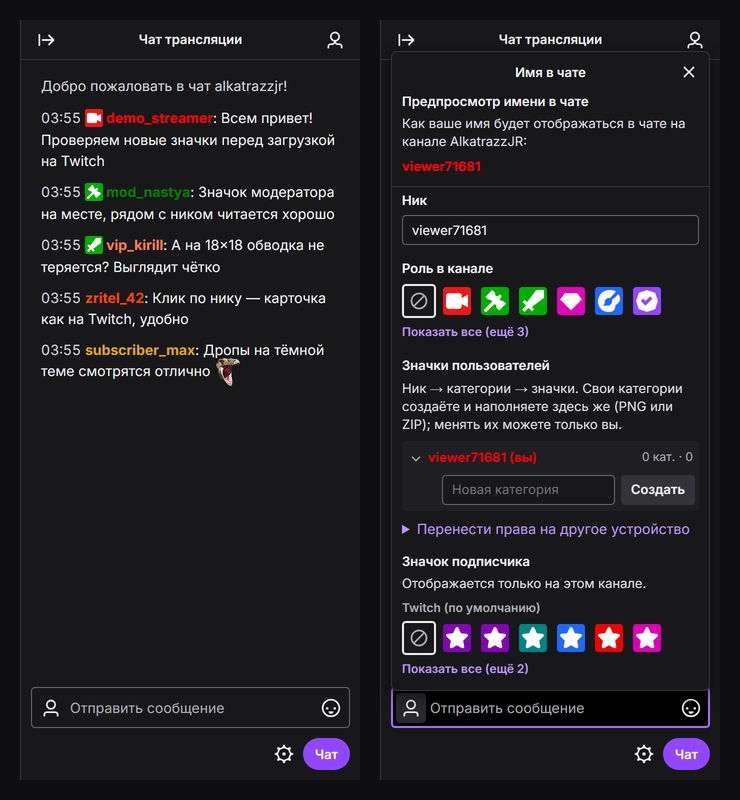

<div align="center">

# Twitch badge chat

**Проверьте значки канала в живом чате до загрузки на Twitch.**<br>
Значки подписчика, Creator Badge Drops, роли и смайлы — так, как их увидят зрители.

[**Открыть сайт →**](https://alkatrazzjr.github.io/twitch-badge-chat/)



</div>

## Что умеет

- **Общий чат в реальном времени.** Все, кто открыл сайт, видят одни и те же сообщения (последние 150).
- **Ваши значки рядом с ником.** Загрузите PNG или ZIP и сразу посмотрите, как значок читается в строке чата и в карточке пользователя.
- **Как на Twitch.** В строке не больше 3 значков: роль, подписка и один дополнительный (дроп, Bits, подарки или общий).
- **Смайлы** Twitch, 7TV, BTTV и FFZ — глобальные и канала.
- **Карточка пользователя** по клику на ник.
- **Без регистрации.** Ник и значки привязаны к браузеру.

## Как пользоваться

1. Откройте [сайт](https://alkatrazzjr.github.io/twitch-badge-chat/) и нажмите значок слева в поле ввода — откроется «Имя в чате».
2. Задайте ник, цвет и роль.
3. В «Значках пользователей» создайте категорию и загрузите PNG или ZIP:
   - `N_18.png`, `N_36.png`, `N_72.png` — значок подписчика за N месяцев;
   - любой другой PNG — значок канала.
4. Выберите значки и напишите в чат — так их увидят зрители.

Ник и категории принадлежат вашему браузеру: менять и удалять их можете только вы. Чтобы работать с другого устройства, откройте «Имя в чате» → «Перенести права на другое устройство».

## Требования Twitch к значкам

| Значок | Формат | Размер | Вес |
|---|---|---|---|
| [Подписчика](https://help.twitch.tv/s/article/subscriber-badge-guide) | PNG с прозрачным фоном | три файла: 18×18, 36×36, 72×72 | до 25 КБ каждый |
| [Creator Badge Drops](https://help.twitch.tv/s/article/creator-badge-rewards) | квадратный PNG без анимации | рекомендуется от 120×120 | до 25 КБ |
| Общий (имитация глобальных) | квадратный PNG | любой | до 100 КБ |

**Creator Badge Drops** (по документации Twitch, август 2026): название до 25 символов; в событии до 3 значков — за подписки или подарки (1–100, обязательный), за просмотр (до 24 ч) и Top Supporter (топ 1/3/5/10); событие длится не больше 28 дней, одновременно активно только одно в пределах категории.

**Общие значки** на Twitch выдаёт только сама платформа — здесь их можно загрузить, чтобы проверить, как они смотрятся рядом с вашими.

## Как устроено

- **Сайт** — статические `index.html`, `style.css`, `app.js` на GitHub Pages.
- **Сервер** — Cloudflare Worker: D1 хранит категории и значки, Durable Object держит общий чат по WebSocket.
- **`rules.js`** — правила Twitch, общие для сайта (подсказки при выборе) и сервера (окончательная проверка).

<details>
<summary>Запуск локально</summary>

Нужны Node.js и Python.

1. Создайте `worker/.dev.vars` со своим ключом владельца:
   ```
   ADMIN_KEY=любая-длинная-случайная-строка
   ```
2. Создайте локальную базу (имя — из `worker/wrangler.toml`):
   ```bash
   cd worker
   npx wrangler d1 execute <database_name> --local --file schema.sql
   ```
3. Запустите сервер:
   ```bash
   npx wrangler dev --port 8791 --ip 127.0.0.1 --local
   ```
4. В другом терминале из корня репозитория запустите сайт и откройте http://localhost:8765/ — на `localhost` он сам обращается к локальному серверу:
   ```bash
   python -m http.server 8765 --bind 127.0.0.1
   ```

</details>

## Лицензия

[MIT](LICENSE)
